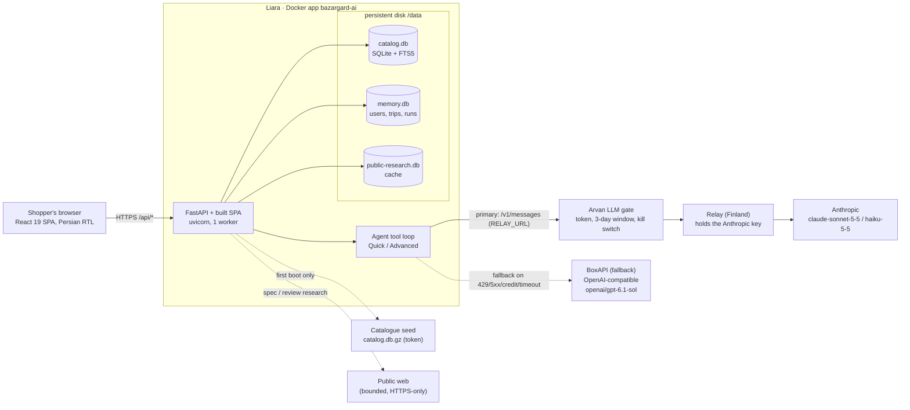

# Bazargard (بازارگرد) — AI in-person shopping assistant for Tehran

[](https://github.com/moazeniz/bazargard/actions/workflows/ci.yml) [](https://github.com/moazeniz/bazargard/actions/workflows/deploy.yml) [](https://bazargard-ai.liara.run) [](https://negahban-sre.liara.run/status)  
  

> **خلاصه فارسی —** بازارگرد یک دستیار خرید حضوری فارسی (راست‌به‌چپ) برای تهران است که برای چالش «ترب» در هکاتون Agentic AI استارکوچ ساخته شده. کاربر نیازش را در گفت‌وگو می‌گوید؛ دستیار در کاتالوگ ترب (۲۲۵ هزار محصول، ۳۳۱ هزار پیشنهاد، ۶٬۴۷۶ فروشگاه) جست‌وجو می‌کند، محصولات را با مشخصات واقعی مقایسه می‌کند، فروشنده‌ها را بر اساس قیمت، فاصله، ساعت کاری و خرید اقساطی فیلتر می‌کند، مسیر بازدید و پیش‌نویس پیام به فروشنده می‌سازد و هیچ ادعایی را بدون منبع مطرح نمی‌کند. بک‌اند FastAPI + SQLite، فرانت‌اند React/Vite؛ مدل زبانی Anthropic از طریق دروازهٔ آروان و رله (با BoxAPI به‌عنوان جایگزین خودکار). استقرار اصلی روی لیارا (اپ Docker با دیسک دائمی `/data`) است. راهنمای کامل پروژه: [فارسی](docs/PROJECT_GUIDE.fa.md) · [English](docs/PROJECT_GUIDE.en.md).

Bazargard is a Persian, right-to-left shopping assistant that takes a shopper from *"I need a phone for my mother under 20 million toman near Valiasr"* to a verified shortlist of real offers, an opening-hours-aware visit route, seller inquiry drafts and a cost/instalment breakdown — while keeping every claim tied to the catalogue, a seller reply, or a labelled public source.

- **Challenge:** Torob — *in-person shopping assistant* (Starcoach Agentic AI Hackathon, October 2026).
- **Status:** release **4.4.1**, live on **Liara** as the Docker app `bazargard-ai` (persistent `/data` disk).
- **Project guide / راهنمای کامل پروژه:** [English](docs/PROJECT_GUIDE.en.md) · [فارسی](docs/PROJECT_GUIDE.fa.md)
- **LLM:** switchable provider (`LLM_PROVIDER=anthropic|boxapi`). In production, Anthropic (`claude-sonnet-5-5`) is the primary provider, reached through the Arvan LLM gate and the relay. BoxAPI (`openai/gpt-6.1-sol`) takes over automatically on 429, 5xx, credit or timeout errors.
- **Hardening:** a prompt-injection and abuse guard (`backend/guard.py`) covers 52 attack classes. It passed all 106 red-team checks against a real model ([redteam/REPORT.md](redteam/REPORT.md), [docs/SECURITY.md](docs/SECURITY.md)).
- **Operations:** JSON logs with request and trace IDs, retries with circuit breakers, and a durable job queue with admin endpoints.

---

## Contents

[Project guide](#project-guide--راهنمای-کامل-پروژه) · [Features](#features) · [Architecture](#architecture) · [Quick start](#quick-start-local-development) · [Configuration](#configuration) · [Tests](#tests) · [Deployment](#deployment) · [Project structure](#project-structure) · [Security](#security-notes) · [Docs](#documentation) · [Team](#team)

## Project guide / راهنمای کامل پروژه

A complete walkthrough of the product for users, judges and maintainers: [docs/PROJECT_GUIDE.en.md](docs/PROJECT_GUIDE.en.md) (English) · [docs/PROJECT_GUIDE.fa.md](docs/PROJECT_GUIDE.fa.md) (فارسی).

## Features

**Shopping conversation (Persian chat, Quick / Advanced modes)**
- Needs discovery with source-backed memory: every saved preference quotes the user's own words; corrections replace earlier values; trip-only vs. permanent memory; named recipient profiles.
- Hard filters that the model cannot loosen: budget, neighbourhood/radius, brand, in-person instalment credit (channel, provider, category and price eligibility), opening hours at the planned visit time.
- *Quick* mode: one direct search, short answer. *Advanced* mode: multi-hop investigation (`plan_research` → parallel query rounds → seller joins → offer inspection → verification), bounded to 12 model rounds / 40 tool calls, with a reviewable query trail.
- Recoverable chat runs: answers are persisted as events and polled, so reloads and dropped connections do not lose them.

**Catalogue and comparison**
- Full Torob dataset in SQLite with Persian-normalised FTS5 retrieval and category-intent guards (phones vs. phone batteries, laptops vs. adapters).
- 2–12 product comparison tables with normalised specs, explicit missing/conflicting values, zero-baseline charts, offline HTML/CSV export, immutable reply snapshots.
- Optional source-attributed spec completion and buying reviews from bounded public web research (manufacturer, spec sites, specialist reviews), never overwriting catalogue facts.

**Trip planning**
- Offer cards with seller-wording inspection (used/refurbished/non-original), opening schedules in Asia/Tehran (split and overnight shifts), nearest-neighbour route of up to four stops, Google Maps links, OpenStreetMap maps with catalogue coordinates.
- Joint basket (up to 6 items / 4 stops), cost and instalment calculator, deadline planning, offline HTML trip pass.
- Seller inquiry drafts, expiring one-use seller reply/hold links, labelled seller-failure simulations with automatic alternatives. **No real calls or messages are ever sent.**
- When the catalogue has nothing: sourced shopping-area suggestions on a map, Tehran merchant discovery and web alternatives — always labelled as unverified leads, never as qualifying offers.

**Ops workspace (`?workspace=ops`)** — a companion for the Liara challenge: isolated sample deployments, HTTP/log/CPU/RSS diagnosis, owner-approved fixes with post-checks and rollback, and a read-only-by-default Liara API client.

See [docs/FEATURES.md](docs/FEATURES.md) for the detailed behaviour and its limits.

## Architecture



- One container serves the API and the built SPA (`frontend/dist`); Liara terminates TLS.
- State is three SQLite files on the `/data` disk. The design is intentionally **single-replica** (in-process jobs, SQLite); scale vertically.
- The model only gets typed tools over the catalogue and the user's own session. There is no SQL, shell, arbitrary URL fetch or outbound messaging tool.
- `backend/llm.py` presents one Anthropic-shaped interface. It talks to Anthropic through the gate and relay (`RELAY_URL`/`RELAY_TOKEN`), or translates to the BoxAPI Responses API with key rotation. A circuit breaker per provider and an automatic fallback mean one outage does not stop a chat. A turn that still fails goes to the durable queue (`chat_retry`).
- Untrusted input passes `backend/guard.py` before it reaches the model. `backend/obs.py` writes JSON logs, `backend/resilience.py` applies the retry policy and circuit breakers, and `backend/jobqueue.py` runs the durable queue.

Details: [docs/ARCHITECTURE.md](docs/ARCHITECTURE.md).

## Quick start (local development)

Requirements: Python 3.12+, Node 20.19+ (22 recommended), the Torob challenge dataset CSVs (see [docs/DATA.md](docs/DATA.md)).

```bash
git clone <repo-url> torob-bazargard && cd torob-bazargard
make install                    # .venv + backend and test dependencies
make install-frontend           # npm ci
make catalog DATASET_DIR=/path/to/torob-csvs   # -> data/catalog.db (one-off, a few minutes)
make frontend-build             # -> frontend/dist
cp .env.example .env            # optional: fill BOXAPI_* to enable chat
set -a; . ./.env; set +a
make run                        # http://127.0.0.1:8506
```

Frontend hot-reload: keep `make run` going and start `make dev-frontend` (Vite proxies `/api` to port 8506).

Without an LLM configured, catalogue search, filters, comparisons, maps, drafts, simulations and visit planning still work; the chat explains that the model is not configured.

Docker:

```bash
make docker-build
make docker-run                 # http://127.0.0.1:8080, ./data mounted at /data
```

## Configuration

All configuration is via environment variables (systemd `EnvironmentFile`, Liara env vars, or `docker --env-file`). Template: [.env.example](.env.example).

| Variable | Required | Default | Description |
|---|---|---|---|
| `PUBLIC_BASE_URL` | **yes** in prod | — | Public origin, e.g. `https://bazargard-ai.liara.run/`. Used for seller reply/hold links and shares. |
| `DATA_DIR` | no | `<repo>/data` (`/data` in the image) | Holds `catalog.db`, `memory.db` (also the job queue), `public-research.db`, `canonical-products.db` and ops lab files. Must be persistent. |
| `LLM_PROVIDER` | no | `anthropic` | Primary model provider: `anthropic` (through the gate and relay) or `boxapi`. |
| `LLM_FALLBACK_PROVIDER` | no | the other provider | Takes over on 429, 5xx, credit or timeout errors. Set it empty to disable fallback. |
| `RELAY_URL` | for `anthropic` | — | Base URL of the Anthropic path: the Arvan LLM gate (`http(s)://<gate>/meow-llm`), which forwards to the relay. Also used for `/routing` and `/place-context` fallbacks. |
| `RELAY_TOKEN` | with `RELAY_URL` | — | Bearer token for the gate. It is a gate token; the Anthropic key never leaves the relay host. |
| `ANTHROPIC_MODEL`, `ANTHROPIC_LIGHT_MODEL` | no | `claude-sonnet-5-5`, `claude-haiku-5-5` | Main and light (guard judge) models on the Anthropic path. |
| `BOXAPI_BASE_URL` | for `boxapi` / fallback | `https://ai.boxapi.ir/ai/v1` | BoxAPI OpenAI-compatible base URL (Responses API). |
| `BOXAPI_KEYS` | for `boxapi` / fallback | — | Comma-separated keys, used round-robin with per-key cooldown and fail-over on 401/402/403/429/5xx/timeouts. |
| `LLM_MODEL`, `LLM_LIGHT_MODEL` | no | `openai/gpt-6.1-sol`, `openai/gpt-6-luna` | Main and light models on BoxAPI. |
| `LLM_FALLBACK_MODELS` | no | `openai/gpt-6-sol,openai/gpt-6-luna` | BoxAPI model fallback chain. |
| `LLM_REASONING_EFFORT`, `LLM_SEARCH_CONCURRENCY`, `LLM_TOOL_RESULT_CHARS` | no | model default, `3`, `30000` | Tuning knobs: reasoning effort, parallel web searches, and the cap on tool-result characters sent to the model. |
| `LLM_PROMPT_CACHE` | no | `1` | Anthropic prompt caching of the system prompt and tool schemas in agent turns. Set `0` to disable. |
| `SPEC_MODEL`, `SPEC_MODEL_SEARCH` | no | `LLM_MODEL`, `1` | Model override for specification harmonisation. `0` disables model-assisted web search for specs and reviews. |
| `ADMIN_TOKEN` | no | unset (admin API disabled) | Enables `/api/admin/queue` and `/api/admin/jobs[...]` (list, inspect, replay, discard) with `Authorization: Bearer`. |
| `LOG_LEVEL`, `LOG_FORMAT`, `APP_ENV` | no | `info`, `json`, `production` | Structured JSON logging (`backend/obs.py`). |
| `CATALOG_URL` | first boot | — | URL of `catalog.db.gz`, downloaded once by `backend/start.py` when `DATA_DIR/catalog.db` is missing. |
| `CATALOG_TOKEN` | with `CATALOG_URL` | — | Bearer token for the seed download. |
| `CATALOG_SHA256` | recommended | — | Expected SHA-256 of the gzip. A mismatch aborts the boot. |
| `PORT`, `FORWARDED_ALLOW_IPS` | no | `8080`, `127.0.0.1` | Listen port of `backend/start.py` (the container entrypoint), and the proxies trusted for `X-Forwarded-*`. |
| `OSRM_URL`, `OVERPASS_URL`, `HTTP_USER_AGENT` | no | public OSRM / Overpass endpoints, Bazargard UA | Road-distance and OSM context providers; user agent for public fetches. |
| `WEB_GATEWAY_URL`, `WEB_GATEWAY_TOKEN` | optional | empty | Optional fetch gateway for public pages. Leave it empty to fetch directly (the default). |
| `DEV_CONSOLE`, `DEV_TRACE_HOURS` | no | unset, `24` | `DEV_CONSOLE=1` enables the in-app developer console (`/api/dev/*`, per-run model, tool and guard trace). Unset, every dev route answers 404. Traces are kept for `DEV_TRACE_HOURS` hours. Leave it unset in production handover. |
| `LIARA_API_TOKEN`, `LIARA_ALLOW_MUTATIONS` | no | —, unset | Liara API client of the ops workspace (`backend/ops.py`). A mutating call needs both `true` and an approved action. |
| `TEST_CATALOG` | tests | — | Absolute path to a real `catalog.db`. Enables the integration tests. |

Observability: every log line is one JSON object with `ts, level, app, env, release, event, request_id, trace_id, span_id, session, msg`. `X-Request-ID` and `traceparent` are accepted and returned. Health: `/healthz` (liveness) and `/api/ready` (alias `/readyz`), which reports catalogue, database, disk, providers, queue backlog and open circuits.

## Tests

```bash
make test                                         # unit tests; catalogue tests skip
make test-full TEST_CATALOG=$PWD/data/catalog.db  # full suite against the real catalogue
make lint                                         # byte-compile + shell syntax
```

386 tests in `tests/` (all pass against the real catalogue): 308 run without the dataset (CI) and 78 more need `TEST_CATALOG`. Coverage includes memory/corrections and session isolation, credit eligibility, Persian normalisation, schedules, hard-filter preservation in multi-hop retrieval, immutable snapshots, seller simulations, SSRF guards in public research, the guard against an attack corpus plus false positives on 77 real shopper messages, LLM provider switching and fallback (fake transport), observability and the job queue, approval/rollback flows of the ops workspace, and Liara API contracts (mocked transport).

CI ([.github/workflows/ci.yml](.github/workflows/ci.yml)) runs lint + unit tests on Python 3.12, `npm ci && npm run build`, and a Docker image build.

## Deployment

| Target | How | Runbook |
|---|---|---|
| **Liara** (production, `bazargard-ai`) | Docker platform via `liara.json`, disk `data` → `/data`, catalogue seeded on first boot; `liara deploy` CLI or `scripts/liara_release.py` (REST API) | [DEPLOYMENT.md → Liara](docs/DEPLOYMENT.md#1-liara-production) |
| Local Docker | `make docker-build docker-run` | [DEPLOYMENT.md → Docker](docs/DEPLOYMENT.md#2-docker-local-or-any-host) |
| Self-hosted VM (optional, legacy) | systemd + nginx templates in `deploy/self-hosted/` | [DEPLOYMENT.md → self-hosted](docs/DEPLOYMENT.md#5-optional-self-hosted-vm-legacy) |

Typical release: `make liara-deploy` → `make liara-status` → on trouble `make liara-rollback`.

Health endpoints: `GET /api/health` (liveness, release, provider) and `GET /api/ready` (503 until the catalogue is loaded). Day-2 operations: [docs/OPERATIONS.md](docs/OPERATIONS.md).

## Project structure

```
torob-bazargard/
├── backend/                 FastAPI app (server.py), agent loop, catalogue, memory, research, ops workspace
│   ├── server.py            HTTP API + static SPA
│   ├── start.py             container entrypoint (catalogue seed + uvicorn)
│   ├── catalog.py           SQLite/FTS5 catalogue; `python backend/catalog.py <csv-dir> <db>` importer
│   └── build_product_index.py  optional derived spec index
├── frontend/                React 19 + Vite SPA (src/, public/, index.html)
├── tests/                   pytest suite (+ fixtures/)
├── scripts/
│   ├── liara_release.py     Liara REST API: deploy, releases, rollback, status, logs, restart
│   ├── liara-package.sh     source tarball honouring .liaraignore
│   ├── publish-catalog-seed.sh  token-protected catalog.db.gz for first boot
│   └── backup-data.sh       online SQLite backups
├── deploy/
│   ├── catalog-seed/        nginx location for the seed download
│   └── self-hosted/         optional VM path: install.sh, systemd unit, nginx, deploy-vm.sh
├── docs/                    project guide (fa/en), architecture, deployment, operations, features, data, security, legacy/
├── Dockerfile · liara.json · .dockerignore · .liaraignore
├── Makefile · requirements.txt · requirements-dev.txt · pytest.ini
└── .env.example · CHANGELOG.md · LICENSE
```

## Security notes

- **No secrets in the repository.** Runtime secrets (gate token, BoxAPI keys, catalogue token, admin token, Liara token) live only in Liara's environment variables, or in a local, gitignored `.env`. The Anthropic API key exists only on the relay host. `.env*`, databases and `data/` are git- and docker-ignored.
- The catalogue (Torob challenge dataset) and `memory.db` (user conversations) are never committed or baked into images.
- Browser identities are random HttpOnly, SameSite=Lax cookies; session ownership is checked server-side; mutating requests enforce same-origin; request bodies are size-limited; expensive endpoints (search, research, specs, reviews, vision) have per-IP hourly limits, and chat is bounded by per-chat tool budgets and one active run per chat. New users and new chats are deliberately not rate-limited, so shared networks are never blocked. API responses are `no-store`.
- A prompt-injection and abuse guard (`backend/guard.py`) normalises Unicode, scans many encodings, keeps an abuse score per conversation that warns and then closes it, fences untrusted data, and filters outputs. Red-team results: [redteam/REPORT.md](redteam/REPORT.md).
- Tool results, seller text, web pages and logs are treated as untrusted data, never instructions. Outbound fetches are HTTPS-only, public-address-only with DNS pinning, size/time bounds and no credentials.
- Dataset phone numbers and most shop names are synthetic; the app never contacts sellers.
- This is a competition deployment, not a hardened multi-tenant service. Full threat model: [docs/SECURITY.md](docs/SECURITY.md).

## Documentation

| Doc | Content |
|---|---|
| [docs/PROJECT_GUIDE.en.md](docs/PROJECT_GUIDE.en.md) · [docs/PROJECT_GUIDE.fa.md](docs/PROJECT_GUIDE.fa.md) | Project guide / راهنمای کامل پروژه |
| [docs/ARCHITECTURE.md](docs/ARCHITECTURE.md) | Components, request flow, data model, design decisions |
| [docs/DEPLOYMENT.md](docs/DEPLOYMENT.md) | Runbooks: Liara (primary), Docker, optional self-hosted VM; upgrades, rollback, backups |
| [docs/OPERATIONS.md](docs/OPERATIONS.md) | Monitoring, alerts, logs, on-call checklist, incident playbooks |
| [docs/FEATURES.md](docs/FEATURES.md) | Functional behaviour and honest limits |
| [docs/AGENT_REASONING.md](docs/AGENT_REASONING.md) | Quick/Advanced agent loop, budgets, multi-hop investigation |
| [docs/DATA.md](docs/DATA.md) | Obtaining the dataset, building the catalogue, data-integrity disclosures |
| [docs/SECURITY.md](docs/SECURITY.md) | Security model and prompt-injection hardening |
| [redteam/REPORT.md](redteam/REPORT.md) | Red-team method and results (baseline vs hardened) |
| [docs/legacy/RELAY_AND_GATEWAY.md](docs/legacy/RELAY_AND_GATEWAY.md) | 3.x egress relay and web gateway (historical) |
| [CHANGELOG.md](CHANGELOG.md) | Release history |

## Team

Built by team **«MeowMeow»** for the **Starcoach Agentic AI Hackathon** (October 2026), Torob challenge.

Licensed under the [MIT License](LICENSE). The Torob dataset is not part of this repository and is subject to the challenge organisers' terms.

<!-- platform:begin -->
## Delivery and operations

This repo ships with the team platform kit: CI (tests, image smoke, gitleaks, audits, SBOM, Trivy), a tag-driven Liara deploy with automatic rollback, and IaC in `infra/liara.app.yaml`. Details: [docs/DEPLOYMENT.md](docs/DEPLOYMENT.md#release-pipeline-infrastructure-as-code-and-health-checks) · [docs/OPERATIONS.md](docs/OPERATIONS.md#platform-operations-slos-backups-runbooks) · team platform overview in `negahban/docs/PLATFORM.md`.
<!-- platform:end -->
