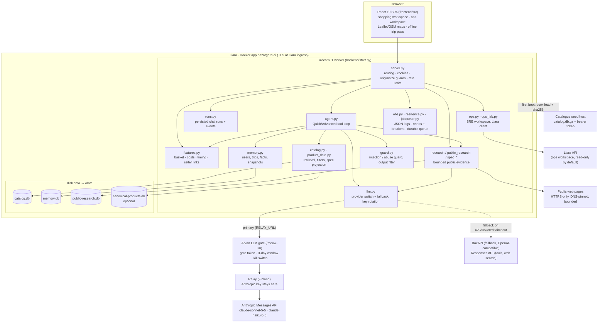
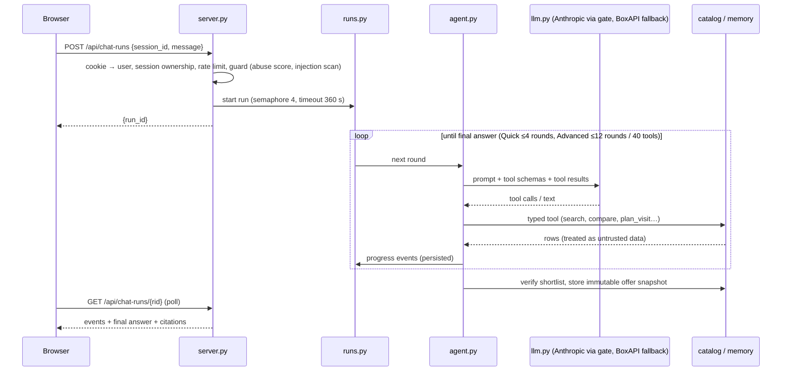

# Architecture

Bazargard is a single-container web application deployed on **Liara**: a FastAPI backend that also serves the built React SPA, three SQLite databases on Liara's persistent `/data` disk, and a switchable LLM provider. The primary provider is **Anthropic**, reached through the Arvan LLM gate and the relay. **BoxAPI** (OpenAI-compatible) is the automatic fallback. Release 4.1.0 adds a guard layer, JSON observability, retries with circuit breakers and a durable job queue.

## 1. Component view



| Module | Responsibility |
|---|---|
| `server.py` | All `/api/*` routes, identity cookie (`hamrah_user`), session ownership checks, same-origin + body-size middleware, per-IP rate limits, security headers, SPA fallback route. `/api/health`, `/api/ready`. |
| `start.py` | Container entrypoint: seeds `catalog.db` from `CATALOG_URL` on an empty disk (503 placeholder while downloading), then runs uvicorn with one worker. |
| `agent.py` | System prompts and typed tools for Quick and Advanced modes, bounded tool loop, immutable offer snapshots, citation binding. |
| `runs.py` | Chat runs as persisted jobs (`assistant_runs`, `assistant_run_events`), max 4 concurrent, 6-minute timeout, recoverable by polling; interrupted runs are labelled after a restart. |
| `catalog.py` | CSV importer, Persian normalisation, FTS5 search, category intent, hard filters (budget, radius, credit, hours), opening schedules, `ClosingConnection`. |
| `product_data.py`, `spec_schema.py`, `basic_specs.py` | Versioned typed spec projection with provenance; category schemas; missing-only completion. |
| `comparison.py`, `buying_review.py`, `review_*`, `user_reviews.py` | Comparison tables/charts, buying-review cards, grounded analysis. |
| `research.py`, `catalogue_first.py`, `public_research.py`, `external_discovery.py`, `web_alternatives.py`, `spec_fetcher.py`, `spec_harmonizer.py`, `spec_jobs.py` | Multi-hop retrieval and bounded public-web evidence (HTTPS-only, DNS-pinned, size/time limits, shared public-only cache). |
| `features.py`, `evidence.py`, `seller_simulation.py`, `visit_checks.py`, `price_policy.py`, `clarification.py` | Basket, costs, deadlines, seller reply/hold links, reported-price overlay, simulations, visit windows, price diversity, clarification questions. |
| `locations.py`, `geo_provider.py`, `areas.py` | Address/entrance context (OSM directly, with relay `/place-context` as a fallback), shopping-area fallback. |
| `llm.py` | Provider layer. One Anthropic-shaped interface. The Anthropic path calls `RELAY_URL/v1/messages`; the BoxAPI path translates to the Responses API with key rotation. Light/main model tiers, a model fallback chain, provider fallback (`LLM_FALLBACK_PROVIDER`), a circuit breaker per provider, usage stats. |
| `guard.py` | Prompt-injection and abuse defence: Unicode normalisation, multi-view detection (encodings, obfuscation), an abuse score per conversation (warn, then close with HTTP 423), fencing of untrusted data, visible-text-only HTML/PDF extraction, and an output filter against prompt or key leaks. See [SECURITY.md](SECURITY.md). |
| `obs.py` | One JSON log line per event (`ts, level, app, env, release, event, request_id, trace_id, span_id, session, msg`, plus typed fields). Propagates `X-Request-ID` and `traceparent`, redacts secrets and PII, runs the global error handler. |
| `resilience.py` | One retry policy for all external calls (exponential backoff with full jitter, `Retry-After`, transient errors only) and a circuit breaker per upstream and per web host. |
| `jobqueue.py` | Durable `job_queue` in `memory.db`. States: queued → running → succeeded, or retrying → dead. Idempotency keys, a retry worker, a dead letter, crash recovery, and admin endpoints guarded by `ADMIN_TOKEN`. |
| `ops.py`, `ops_lab.py` | Ops (SRE) workspace: isolated lab processes, evidence collection, approval-gated actions, Liara API adapter. |

## 2. Request flow: a chat turn



## 3. Data

| File (`DATA_DIR/…`) | Content | Lifecycle |
|---|---|---|
| `catalog.db` | `products`, `shops`, `offers`, `product_fts`, `metadata` imported from the Torob CSVs | Built offline (`make catalog`) or seeded from `CATALOG_URL`. Read-mostly; rebuildable. |
| `canonical-products.db` | `product_facts`: compressed typed spec projections | Optional, derived (`make product-index`); stale rows fall back to per-request projection. |
| `memory.db` | `users`, `sessions`, `turns`, `facts`, `shopper_profiles`, `assistant_runs(_events)`, `comparison_snapshots`, `seller_events`, `merchant_requests`, `basket_items`, `clarification_state`, `ops_actions`, `ops_audit`, `job_queue` (durable queue), guard state (closed conversations) | **Irreplaceable user state — back up.** |
| `public-research.db` | Public-source caches (research, harmonised specs, OSM/geo, user reviews) | Cache; TTL-bounded; safe to delete. |
| `ops-labs/` | Per-session sample processes of the ops workspace | Ephemeral. |

All SQLite access uses short-lived connections (`ClosingConnection`: commit/rollback then close) to avoid descriptor leaks in a long-running worker.

## 4. Key design decisions

- **Single worker, single replica.** Chat runs, spec jobs and ops labs are in-process; SQLite is local. The job queue is durable (`memory.db`), so work survives restarts. Horizontal scaling would need a server database.
- **Catalogue first, evidence always.** Every product claim comes from a retrieved record, a user-reported seller reply (`user_reported`), a labelled simulation (`simulated`) or a cited public source. Unknown stays unknown.
- **Hard constraints are code, not prompt.** Budget, radius, credit and hours are enforced by the catalogue layer on every branch; the model cannot widen them.
- **No dangerous tools.** No SQL, shell, arbitrary URL fetch or outbound messaging is exposed to the model. Public research takes only extracted model/category strings, never the shopper's private context.
- **Minimal egress dependencies.** Public pages, OSRM and OSM are fetched directly. The relay serves only the Anthropic path and optional `/routing` and `/place-context` fallbacks, behind the token-checked Arvan gate. A failure degrades explicitly (BoxAPI fallback, manual travel times, "unavailable" map context) instead of breaking the turn. The 3.x web gateway is retired ([legacy note](legacy/RELAY_AND_GATEWAY.md)).
- **One image.** The Dockerfile builds the SPA and runs as a non-root user; Liara builds it from the uploaded source, and local Docker runs the same image. `start.py` seeds the catalogue onto an empty disk before the app imports it.
- **Liara platform fit.** Liara offers on/off scaling only (no replicas), a persistent disk per app, release history with rollback, and per-hour billing — matching a single-replica SQLite design.

## 5. LLM provider

`LLM_PROVIDER=anthropic|boxapi` selects the primary provider; the default is `anthropic`. `LLM_FALLBACK_PROVIDER` (by default the other provider, empty to disable) takes over on 429, 5xx, credit, auth or timeout failures.

```
Liara app --HTTPS/HTTP + RELAY_TOKEN--> Arvan nginx gate (/meow-llm: token, 3-day window, kill switch)
          --SSH tunnel--> relay (Finland, holds the Anthropic key) --> Anthropic Messages API
          \--fallback--> BoxAPI (https://ai.boxapi.ir/ai/v1, BOXAPI_KEYS round-robin)
```

- **Anthropic path:** Anthropic-format bodies go to `RELAY_URL/v1/messages` with `Bearer RELAY_TOKEN`. Liara holds only the gate token; the Anthropic key never leaves the relay. Models are `claude-sonnet-5-5` (main) and `claude-haiku-5-5` (light; it is the guard judge).
- **BoxAPI path:** call sites keep Anthropic-shaped bodies. `llm.py` translates them to the Responses API (function tools, `web_search`) and translates the answer back, so the agent loop is provider-neutral. Keys rotate with per-key cooldown. The model chain is `openai/gpt-6.1-sol` → `LLM_FALLBACK_MODELS`.
- **Resilience:** each provider has a circuit breaker (`resilience.py`). A chat turn that fails on both providers is stored as a `chat_retry` job and finished by the queue worker. `/api/health` reports both providers' status.
- **Secrets:** keys and tokens are redacted from errors, logs and stats.

Release history: 3.x called the relay directly; 4.0.0 moved to BoxAPI only; 4.1.0 makes the provider switchable, with Anthropic through the gate as the primary. See [legacy/RELAY_AND_GATEWAY.md](legacy/RELAY_AND_GATEWAY.md) for the 3.x setup.
