# بازارگرد benchmark on the Torob dataset

Generated 2026-10-23 06:59 by `make bench` from `bench/results/*.json` (raw per-query results are committed next to this report). Labelled set: **61 Persian requests** in 10 groups. Retrieval runs without any model; the agent run uses the production agent with Claude through the LLM gate.

## 1. How the labels were made

- Each request in `bench/spec.py` has: the natural sentence a shopper types, the concise catalogue phrase plus hard constraints a correct parse yields (budget, district, open at a fixed visit time, in-person credit), and the expectation (acceptable catalogue categories, model or brand tokens that must be in the title, or *not in Torob*).
- `bench/bench.py build` checks every label against the catalogue and records the ground truth (`truth.products` = how many products satisfy all constraints). For «not in Torob» items the truth is 0 by construction (e.g. no Leica TV, no Kindle, no Bosch dishwasher, no electric bicycle, no microwave oven under 8M toman). A label that disagrees with the catalogue stops the build.
- Open-now uses fixed visit times (Saturday 11:00 and Friday 20:00 Tehran) so results are reproducible.

## 2. Retrieval without the LLM (catalogue search + ranking)

Two paths are measured: **ranked** (balanced ranking, top 10) and **agent first search** (what the agent receives first: the price-stratified 1/2/2 spread of five distinct products).

| Metric | Ranked | Agent first search | Baseline ranked* | Baseline agent* |
|---|---|---|---|---|
| Precision@5 (category/intent match) | 95.8% | 92.6% | 83.8% | 82.2% |
| Precision@10 | 92.9% | 92.8% | 82.1% | 82.4% |
| Success@5 (≥1 correct item in top 5) | 96.3% | 94.4% | 87% | 87% |
| Zero-result rate (when results exist) | 3.7% | 3.7% | 3.7% | 3.7% |
| Constraint satisfaction (all checks) | 100% | 100% | 100% | 100% |
| — budget | 100% | 100% | 100% | 100% |
| — area | 100% | 100% | 100% | 100% |
| — open | 100% | 100% | 100% | 100% |
| — credit | 100% | 100% | 100% | 100% |
| Accessories in top 5 of «main product» queries | 0% | 0% | 0% | 10% |

\* Baseline = release 4.2.0 search code on the same labels (`BENCH_TAG=-baseline`), before the general fixes listed in section 6.

**Not in Torob (7 queries):** no false match in 100%; the gap is explicitly signalled (empty result, relaxed term reported, accessories-only flag or no matching item) in 100%. The agent turns this signal into «در دیتاست ترب پیدا نشد» (section 3).

**Latency** (catalogue only, 225,903 products / 331,506 offers, one process):

| | p50 | p95 |
|---|---|---|
| Ranked search, warm | 111.3 ms | 1020.1 ms |
| Agent first search (spread), warm | 121.2 ms | 765.1 ms |
| Both searches, cold caches | 297.1 ms | 1731.4 ms |

### By request type (ranked, precision@5)

```mermaid
xychart-beta
  title "Precision@5 by request type (ranked search)"
  x-axis ["Budget", "Brand", "Area", "Open", "In-person", "Model", "Misspelling", "Accessory", "Multi-constraint"]
  y-axis "precision@5 %" 0 --> 100
  bar [67.5, 93.3, 100.0, 60.0, 96.0, 97.1, 36.7, 90.0, 88.0]
  bar [95.0, 93.3, 100.0, 100.0, 100.0, 97.1, 50.0, 96.7, 100.0]
```



Bars: baseline (first), current (second).

| Type | Queries | p@5 now | success@5 now | p@5 baseline |
|---|---|---|---|---|
| Budget | 8 | 95% | 100% | 67.5% |
| Brand | 6 | 93.3% | 100% | 93.3% |
| Area / district | 6 | 100% | 100% | 100% |
| Open now | 5 | 100% | 100% | 60% |
| In-person credit | 5 | 100% | 100% | 96% |
| Model codes | 7 | 97.1% | 100% | 97.1% |
| Misspelling / Finglish | 6 | 50% | 66.7% | 36.7% |
| Accessory trap | 6 | 96.7% | 100% | 90% |
| Multi-constraint | 5 | 100% | 100% | 88% |

**Remaining misses (no correct item in the ranked top 5):** `s2` «لبتاپ ایسوس»; `s5` «goshi samsung». Finglish such as «goshi samsung» and split words such as «لبتاپ» (for «لپ تاپ») are not recognised by the catalogue search. In the agent, the model rewrites these requests into catalogue words before searching (section 3).

## 3. End to end with the agent

17 requests from the set (`E2E` in `bench/spec.py`), sent one at a time to the running app as a shopper would (new chat, advanced mode). The model is Claude Sonnet through the LLM gate, the same path as production. Run at 2026-10-23T06:59.

| Metric | Result |
|---|---|
| Requests answered without error | 17/17 |
| Cards in the requested category / intent | 100% |
| Cards satisfying the hard constraints (budget, district, open, credit) | 100% |
| Answers with result cards when results exist | 100% |
| «Not in Torob» said plainly when nothing matches | 100% |
| Wrong «not found» when the catalogue has a match | 0% |
| Citations [n] that point to a visible card | 100% |
| Answers that cite cards when results exist | 100% |
| Price mentions in answers / hallucinated (no card or stated budget within 5%) | 44 / 0% |
| Response time p50 / p95 | 11.1 s / 27.2 s |
| Mean model rounds per answer | 2.5 |

| Request | Type | Time | Cards | Card intent / constraints | Cited | Says «not found» | Prices / hallucinated |
|---|---|---|---|---|---|---|---|
| «یه هدفون بی‌سیم تا ۳ میلیون می‌خوام» | Budget | 12.1 s | 5 | 5/5 · 5/5 | 4 | no | 1 / 0 |
| «لپ تاپ تا ۳۰ میلیون برای دانشگاه» | Budget | 16.3 s | 5 | 5/5 · 5/5 | 4 | no | 1 / 0 |
| «لپ تاپ لنوو» | Brand | 10.0 s | 5 | 5/5 · 5/5 | 5 | no | 5 / 0 |
| «هدفون از مغازه‌های شیخ هادی» | Area / district | 11.1 s | 5 | 5/5 · 5/5 | 5 | yes | 5 / 0 |
| «پاوربانک تا ۳ میلیون که الان باز باشه» | Open now | 11.0 s | 5 | 5/5 · 5/5 | 4 | no | 5 / 0 |
| «دوربین مدار بسته قسطی حضوری» | In-person credit | 9.5 s | 5 | 5/5 · 5/5 | 5 | no | 4 / 0 |
| «گوشی سامسونگ A55» | Model codes | 11.6 s | 7 | 7/7 · 7/7 | 5 | no | 4 / 0 |
| «هدفون کیو سی وای T13» | Model codes | 9.9 s | 2 | 2/2 · 2/2 | 2 | yes | 1 / 0 |
| «هدفن بلوتوث» | Misspelling / Finglish | 11.0 s | 5 | 5/5 · 5/5 | 5 | yes | 4 / 0 |
| «لبتاپ ایسوس» | Misspelling / Finglish | 11.1 s | 5 | 5/5 · 5/5 | 5 | yes | 1 / 0 |
| «goshi samsung» | Misspelling / Finglish | 11.0 s | 5 | 5/5 · 5/5 | 5 | no | 5 / 0 |
| «تلویزیون ۵۵ اینچ لایکا» | Not in Torob | 16.4 s | 0 | 0/0 · 0/0 | 0 | yes | 0 / 0 |
| «ماشین ظرفشویی بوش» | Not in Torob | 24.2 s | 1 | 0/1 · 1/1 | 0 | yes | 0 / 0 |
| «یک مایکروویو خوب زیر ۸ میلیون» | Not in Torob | 27.2 s | 16 | 0/16 · 16/16 | 0 | yes | 2 / 0 |
| «جارو برقی» | Accessory trap | 10.3 s | 5 | 5/5 · 5/5 | 5 | yes | 1 / 0 |
| «هدفون بی‌سیم زیر ۲ میلیون در شیخ هادی که الان باز باشه» | Multi-constraint | 13.0 s | 5 | 5/5 · 5/5 | 5 | no | 3 / 0 |
| «گوشی شیائومی زیر ۱۵ میلیون در فردوسی» | Multi-constraint | 8.9 s | 1 | 1/1 · 1/1 | 1 | yes | 2 / 0 |

«Says not found» also triggers on partial statements («X در این بازه پیدا نشد») next to real results. The strict metric above only counts a wrong claim when no card is shown. «Near alternative» cards may accompany a «not in Torob» answer. They are shown with their own label and are not cited as matches.

## 4. Data fidelity

For every card shown in the agent run, the displayed fields were traced back to the catalogue row by `offer_id`:

| Check | Result |
|---|---|
| Offer exists in the dataset | 100% |
| Displayed price = dataset `price_toman` (or a labelled seller report) | 100% |
| Displayed price age = now − `last_price_changed_at` | 100% |
| Stock shown as unknown unless a seller report exists | 100% |
| «Real name» only for shops with website/Instagram in the dataset; others labelled synthetic | 100% |
| Synthetic shop names and phone numbers disclosed in the app notices | yes |

## 5. Rerun

```bash
make bench                        # labels + dataset facts + retrieval benchmark + this report (no model calls, ~1 min)
make bench-e2e BASE=http://127.0.0.1:8611/   # agent benchmark against a running app (17 model-backed chats, ~4 min)
make bench-baseline OLD=/path/to/old/backend # optional: same labels on an older build
```

Inputs: `bench/spec.py` (labels), the catalogue at `data/catalog.db` (override with `CATALOG=`). Outputs: `bench/results/queries.json`, `retrieval.json`, `retrieval-baseline.json`, `e2e.json`, `dataset.json`. No secrets are stored in results.

## 6. What the benchmark changed (general fixes, no per-query rules)

- **Persian suffixes:** catalogue words of 4+ letters now match by prefix, so «بلوتوث» finds «بلوتوثی» and «گوشی» finds «گوشی‌ها». Bluetooth speaker budget queries went from wrong categories to correct ones.
- **Spelling:** a rare query word is corrected to the most frequent catalogue word one edit away («هدفن» → «هدفون»), using the catalogue vocabulary (FTS5 vocab). Known words are never changed. The correction is reported to the agent as `corrected_terms`.
- **Accessories versus products:** a category the query itself names is the product, not an accessory, so «پاوربانک» returns power banks, not power-bank modules. Categories that start with an accessory noun (پاکت، کارتریج، شارژر، لوازم یدکی…) sink unless that noun is asked for. Accessories in the top 5 of main-product queries in the agent's first search: baseline → current shown above.
- **Category ranking:** categories that contain more of the query words rank first («لامپ LED» → «لامپ LED و کم مصرف»).
- **Brand filter:** a brand also matches when it is named in the title. The first agent run showed «هدفون QCY T13» failing because QCY products are listed under the brand شیائومی. That request now returns the right cards.
- **Implausible prices:** offers priced under 1,000 or over 10 billion toman (data errors, see DATASET.md) are flagged in the offer inspection.

## 7. Limits of this benchmark

- The labels were written by the team. They were checked against the catalogue, but there is no external relevance judgement. The category labels decide what counts as «correct».
- Open-now and in-person credit are checked with the same schedule and credit rules the app uses (dataset weekly hours, payment options). They show the filter is applied consistently, not that a shop is really open.
- The agent set is small (15 requests) to keep model cost low, and answers vary from run to run.
