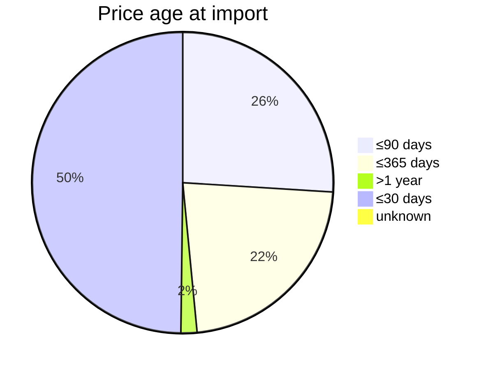

# The Torob dataset in بازارگرد

All numbers are computed from the catalogue database by `backend/dataset_facts.py` (`make bench` → `bench/results/dataset.json`). Source: Starcoach v16 cap300 / Torob, imported 2026-10-22. The same numbers appear in the app under «درباره داده‌ها» (menu → درباره داده‌ها, rail → داده‌ها).

## Size and coverage

| Item | Value |
|---|---|
| Shops | 6,476 (all with coordinates, all inside Tehran) |
| Shops with a real identity (website or Instagram in the source) | 112 — website 90, Instagram 22 |
| Shops whose names are synthetic | 6,364 |
| Phone numbers | 6,476 shops have a phone field; **all numbers are synthetic** |
| Offers (shop × product with a price) | 331,506 |
| Products | 225,903 in 3,428 categories; 57,634 have a brand |
| Products per shop | at most 300 (the dataset cap); 461 shops are at the cap; median 27 offers per shop |
| Districts (location labels) | 30; largest: فردوسی (3,282), شیخ هادی (1,587), بهارستان (616), آسمان (151), باغ فیض (107), ایرانشهر (99) |
| Declared opening hours | 4,447 shops (69%); 980 declare all 7 days; 2,029 have none |
| In-person credit / installments | 82 shops |
| Offers with warranty text / description | 58,838 / 38,268 |

## Prices

| | toman |
|---|---|
| Median | 3,640,000 |
| 90th percentile | 49,900,000 |
| Implausible (< 1,000 toman) | 1,645 offers |
| Implausible (> 10 billion toman) | 211 offers |

Price age is measured from `last_price_changed_at` to the import date:

| Age | Offers | Share |
|---|---|---|
| ≤30 days | 164,714 | 49.7% |
| ≤90 days | 85,954 | 25.9% |
| ≤365 days | 74,367 | 22.4% |
| >1 year | 5,702 | 1.7% |
| unknown | 769 | 0.2% |

## Top categories by offers

| Category | Offers |
|---|---|
| سیم و کابل برق ساختمان | 7,837 |
| دوربین مدار بسته | 5,903 |
| ژنراتور و موتور برق | 3,496 |
| تاچ و ال سی دی گوشی و تبلت | 3,285 |
| چراغ پنلی و سقفی | 3,220 |
| پمپ خانگی و صنعتی | 3,093 |
| ساعت مچی عقربه‌ ای و دیجیتالی | 2,903 |
| سوکت و کانکتور | 2,671 |
| کلید و فیوز مینیاتوری | 2,659 |
| هدفون، هدست و هندزفری | 2,602 |
| کیف و کاور گوشی | 2,396 |
| رله و بیمتال | 2,385 |

## Payment options in the data

| Provider · channel | Shops |
|---|---|
| ترب‌پی · unknown | 140 |
| اسنپ‌پی · in_person | 53 |
| ترب‌پی · in_person | 50 |
| دیجی پی · in_person | 45 |
| اسنپ‌پی · unknown | 36 |
| تارا · in_person | 26 |
| دیجی پی · unknown | 16 |
| تارا · unknown | 11 |
| ازکی‌وام · unknown | 5 |
| دکان ابزار · unknown | 1 |
| تجهیزات آشپزخانه حلما · unknown | 1 |
| جیتکس مارکت · unknown | 1 |

## How each field is used and labelled

| Field | Used for | Shown as |
|---|---|---|
| `offers.price_toman`, `last_price_changed_at` | Budget filters, ranking, price spread, comparison price row | «قیمت ثبت‌شده در ترب، نه زنده» with the age of the price; seller reports appear as a separate labelled price |
| Stock | Not in the dataset | «موجودی نامشخص» until the shopper records a seller reply (labelled «گزارش کاربر», «پاسخ لینک فروشنده» or «شبیه‌سازی») |
| `shops.name`, `contacts` | Shop identity | Cards say «نام ساختگی» unless the shop has a website/Instagram («هویت منبع»). Phone numbers are never dialled or messaged; the follow-up dialog uses the shopper's own apps |
| `shops.instagram`, `website_url` | Real follow-up channels | «پیام در اینستاگرام» / «سایت فروشگاه» buttons (112 shops) |
| `lat`, `lon`, `address`, `location_label` | Distance, district filter, map, route order | Straight-line distance; road time from OSRM without live traffic; indoor floor/unit quoted from the address text |
| `weekly_hours` | Open-now filter and visit planning | «طبق برنامه باز/بسته» (schedule, not verified); shops without hours are «ساعت نامشخص» and are never assumed open |
| `payment_options` (channel, provider, price range, categories) | In-person credit filter | Only `in_person` options whose price range and categories fit count; online or unknown credit is not proof |
| `products.specs`, `category_name`, `brand_name` | Search, comparison table, decision questions | Each comparison cell quotes the catalogue text it came from; web-completed cells are marked with their source link |
| `seller_title`, `description`, `warranty` | Offer inspection (used/stock/copy wording, variant mismatch, missing warranty, implausible price) | Flags with the quoted words |

## Known data issues

- 1,645 offers under 1,000 toman and 211 over 10 billion toman: data errors. They are flagged in the offer inspection and the benchmark excludes none of them.
- 2,029 shops have no opening hours. Open-now filters exclude them, and plans show «ساعت نامشخص».
- The dataset `model` field is often an internal slug (e.g. `authentic-base-10396`). Model codes for review lookup are taken from the title instead.
- Coverage is partial: about 10% of Tehran shops and at most 300 products per shop. «Not in the dataset» is never presented as «not in the market».
